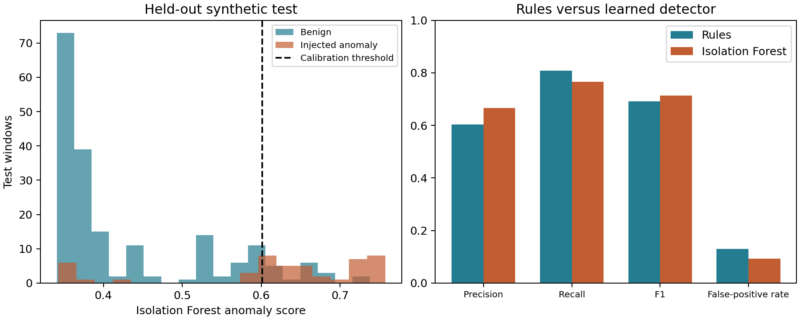

# LabGuard: cybersecurity for scientific information systems

A runnable, local-only Python research sandbox demonstrating project-scoped access controls, transactional audit logging, and anomaly detection for a fictional food-science laboratory. **All samples, identities, activity and attack labels are synthetic.** This is a research prototype, not a production LIMS or a compliance certification.

## Research question

How effectively can role and project restrictions, tamper-evident audit records, and behavioral anomaly detection protect a simulated scientific workflow—and where do these controls fail?

## Quick start

Use Python 3.11 or 3.12. The recorded experiment used Python 3.12.14.

```bash
python -m venv .venv
source .venv/bin/activate
# Windows PowerShell: .venv\Scripts\Activate.ps1
python -m pip install -r requirements.txt
python -m unittest discover -s tests -v
python -m labguard.research
python -m labguard.sensitivity
python -m labguard.demo
```

The experiment recreates `data/events.jsonl`, `data/windows.csv`, and the metrics, predictions and chart under `results/`. No external dataset, credentials, paid service, or GPU is needed. Dependencies require an initial download. Never commit your virtual environment or `.labguard` state.

## Use the simulated laboratory

```bash
python -m labguard init
python -m labguard provision alice technician food-a
python -m labguard provision bob researcher food-a
python -m labguard provision carol auditor food-a
python -m labguard act alice read --sample S001
python -m labguard act alice write --sample S001 --value "Simulated pH: 6.6"
python -m labguard act bob export
python -m labguard act alice read --sample S002
# Expected: access denied; S002 belongs to food-b. A denial is logged.
python -m labguard act carol audit
python -m labguard verify
python -m labguard score
```

Provisioning and action commands prompt for passwords; use at least 14 characters. Each `act` logs in, performs one action and revokes its token on exit. `score` verifies and aggregates local audit events, trains on the bundled reference training split, calibrates on its calibration split and prints alerts. It is an offline demonstration, not a background monitor. Very small local sessions differ from the simulator, so their scores are not calibrated operational risks. `verify` prints the chain head; independently retaining a trusted head is necessary to detect suffix truncation. The Python API supports `lab.verify(expected_head=...)` for that check.

`init` refuses to overwrite an existing directory. Use `--directory PATH` before the subcommand to create a second independent sandbox. User provisioning, verification, and scoring are trusted operator functions. Anyone who can read or edit the local files controls this sandbox; it is not a multiuser operating-system security boundary. The program opens no network listener.

## Permissions

| Role | Read | Write | Export | Audit |
|---|---|---|---|---|
| Technician | Own project | Own project | Denied | Denied |
| Researcher | Own project | Denied | Own project | Denied |
| Auditor | Denied | Denied | Denied | All event metadata |
| Admin | Denied | Denied | Denied | All event metadata |

Admin deliberately has no sample-data bypass. A trusted local operator provisions identities separately. Unknown actions, missing samples, unknown sessions and expired sessions are denied. Every user receives one project scope. There is no cross-project collaboration mechanism in this prototype.

## Results included

The seed-42 held-out test contains 240 windows, including 47 injected anomalies. All 13 tests passed in the supplied environment.

| Detector | Precision | Recall | F1 | False-positive rate |
|---|---:|---:|---:|---:|
| Fixed rules | 60.3% | 80.9% | 69.1% | 13.0% |
| Isolation Forest | 66.7% | 76.6% | 71.3% | 9.3% |



These are measured simulation results, not real-laboratory accuracy claims. Quiet misuse was missed by both detectors. Read the [technical report](docs/technical_report.md), [dataset card](docs/dataset_card.md), [threat model](docs/threat_model.md), and [model card](docs/model_card.md).

## Repository guide

- `labguard/core.py`: authentication, permissions, SQLite transactions and HMAC audit chain.
- `labguard/__main__.py`: local command-line application.
- `labguard/research.py`: simulator, shared window aggregator, model evaluation and chart.
- `labguard/sensitivity.py`: five fixed-seed replications.
- `tests/`: authorization, session, tampering, audit failure and leakage checks.
- `data/`: reproducible raw synthetic activity and labeled windows.
- `results/`: measured metrics, predictions, test transcript and runtime inventory.
- `.github/workflows/tests.yml`: tests and a benchmark run on GitHub pushes and pull requests.

## Repository and author

Maintained by Abass Ajagbe.

- GitHub: https://github.com/Abass69/labguard-scientific-security
- LinkedIn: https://www.linkedin.com/in/abass-ajagbe-70a8801b8/

Independent research-preparation prototype developed with AI assistance. The included results are benchmark results; real-world laboratory validation remains outstanding. See the technical report for methodology and limitations.

