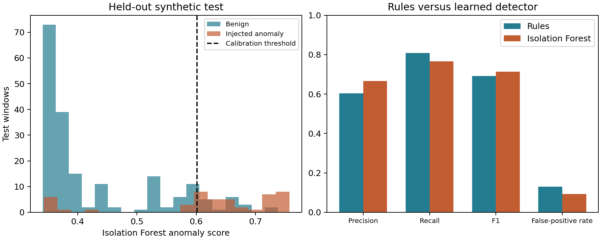

# LabGuard: cybersecurity for scientific information systems

Technical report · 15 November 2026 · Reproducible synthetic pilot

## Abstract

This project investigates role and project restrictions, transactional audit logging, and behavioral anomaly detection for a simulated laboratory information system. A local Python application protects fictional food-science results, while a reproducible simulator generates activity for detector evaluation. On a chronological test set of 240 windows with 47 injected anomalies, Isolation Forest achieved precision 0.667, recall 0.766 and F1 0.713; a fixed-rule baseline achieved F1 0.691. Both detectors missed ordinary-looking misuse. These findings demonstrate an experimental method and its limitations, not operational readiness or validated real-laboratory performance.

## 1. Motivation and implementation

Scientific information systems must protect access to experimental records and the integrity of changes. An authorized identity can also misuse legitimate permissions. The research question is whether an unsupervised detector adds useful evidence beyond access controls and simple rules, particularly when legitimate bulk work resembles misuse. The food-lab setting connects scientific data stewardship with cybersecurity and AI automation.

The Python application applies an explicit deny-by-default role/action policy and per-record project checks, consistent with OWASP authorization guidance [1]. Technicians read and update their own project's records; researchers read and export their own project's records; auditors and admins inspect event metadata without a sample-data bypass. Salted scrypt password hashes, random opaque sessions, 15-minute expiry, logout revocation and temporary account lockout demonstrate authentication controls.

SQLite transactions couple record changes with audit appends. A sequenced HMAC-SHA256 chain links canonical JSON events to their preceding digest. Authentication and authorization outcomes are recorded without passwords, tokens or scientific result bodies, informed by OWASP logging guidance [2]. A forced audit failure test confirms that an update rolls back. An independently trusted chain head is required to detect suffix truncation. Host or key compromise defeats this boundary: the log is tamper-evident, not immutable.

This is a local CLI and callable Python core, with no network listener. The operator, process, filesystem and key are trusted. It demonstrates restrictions on application identities, not isolation from a hostile OS owner. It is not a complete LIMS or compliance implementation.

## 2. Dataset and methodology

The generator produced **19,336 synthetic events**, 12 fictional users and 720 user/15-minute windows across 60 days. No real institution, sample data, identities or attack traffic were used. Each user has one active window per day. Telemetry is generated directly from documented distributions, not replayed through the access-control application. Both components share the event schema and aggregation code.

Training uses days 0–29 (360 windows), calibration days 30–39 (120), and testing days 40–59 (240). Training and calibration contain normal activity and legitimate batches. The test period adds failed-login bursts, scope probes, bulk exports and quiet misuse. Quiet misuse deliberately shares the ordinary observable distribution. Labels are generator assignments, not analyst-verified malicious intent. Test anomaly prevalence is 19.6%, limiting precision comparisons with lower-prevalence deployments.

Features are request count, denials, failed logins, successful exports, records accessed and off-hours activity. Identity, timestamps, split markers, labels and scenario names are excluded from model features. Users recur across splits: this is future-activity evaluation for a fixed population, not transfer to unseen users or laboratories.

Isolation Forest [3] uses 200 trees, max_samples=256 and model random seed 42. Training uses only the first split. The alert threshold is the 95th percentile of benign calibration scores (`method='higher'`), with strict greater-than alerting. There was no hyperparameter search or test-set threshold tuning. The baseline flags five failed logins, ten denials, or eight exports together with sixty records within a window. Rules are not calibrated to the same false-positive budget; the comparison is descriptive rather than a matched-operating-point superiority test.

## 3. Measured results

| Detector | Precision | Recall | F1 | False-positive rate | TP / FP / FN / TN |
|---|---:|---:|---:|---:|---|
| Fixed rules | 0.603 | 0.809 | 0.691 | 0.130 | 38 / 25 / 9 / 168 |
| Isolation Forest | 0.667 | 0.766 | 0.713 | 0.093 | 36 / 18 / 11 / 175 |

Isolation Forest's average precision was 0.698 and ROC AUC 0.848. Its test false-positive rate exceeded the nominal calibration budget, illustrating that calibration on a small benign sample does not guarantee the same future rate. A descriptive 500-resample window-bootstrap F1 percentile interval was 0.602–0.798. Repeated users violate independence; this interval does not measure real-world uncertainty.

Both detectors flagged all 15 login-burst and 12 scope-probe windows. Isolation Forest detected 9 of 11 bulk-export windows; rules detected 11. Both missed all 9 quiet-misuse windows. Of 29 legitimate batch windows, Isolation Forest flagged 17 and rules flagged 25. Legitimate batches therefore accounted for 17 of the learned detector's 18 false positives. Workflow context and alert burden are central research concerns.

Five fixed-design replications changed the simulator seed while retaining the model settings and seed:

| Simulator seed | Isolation Forest F1 | Rule F1 |
|---|---:|---:|
| 42 | 0.713 | 0.691 |
| 43 | 0.737 | 0.768 |
| 44 | 0.667 | 0.679 |
| 45 | 0.741 | 0.708 |
| 46 | 0.685 | 0.679 |

Neither method consistently dominates. These replications assess synthetic sampling variation, not independent laboratories or empirically observed attacks.



## 4. Validation and reproducibility

All **13 automated tests passed** in Python 3.12.14, NumPy 2.3.5 and scikit-learn 1.8.0. Coverage includes the implemented role/action matrix, project-scoped read/export access, invalid/expired/revoked sessions, lockout, an injection-shaped identifier, secret exclusion, audit tampering, trusted-checkpoint truncation detection, audit-failure rollback, deterministic generation, split ordering, feature aggregation and fitting independence from test features. A separate noninteractive demo exercises permitted and denied actions, verifies the audit chain and scores its local telemetry.

Run these commands from the repository root after installing `requirements.txt`:

```bash
python -m unittest discover -s tests -v
python -m labguard.research
python -m labguard.sensitivity
python -m labguard.demo
```

Metrics, test predictions, charts, a test transcript, dependency versions and a raw-data SHA-256 are included. A GitHub workflow is supplied but was not run on GitHub during preparation. Tests are not an exhaustive security proof or a penetration test. Dataset and model cards document assumptions and exact fields.

## 5. Limitations and research extensions

The dataset is small, fully synthetic and based on hand-selected attacks, repeated users, simplified workloads and elevated anomaly prevalence. Most injected scenarios alter the same aggregate counts used for detection; performance partly reflects generator design. The quiet-misuse case shows that intent cannot be inferred from indistinguishable features. No real-lab validation, throughput measurement, network attack evaluation or concept-drift experiment is included.

The prototype lacks MFA, remote authorization, TLS, external key management, immutable remote logs, scientific result versioning, approval workflows and regulatory validation. Account lockout can enable denial of service. Audit verification is explicit rather than enforced before every request. The application has only two fictional records; the larger synthetic telemetry is not an end-to-end application workload. Local live scores are a demonstration under distribution mismatch, not calibrated operational risk estimates.

A useful next study would add approved batch-job context and instrument identities, preregister thresholds, match false-positive budgets, and evaluate held-out users and controlled workload shifts. Real-log evaluation would require institutional authorization, de-identification, governance and qualified incident labeling. For research applications, describe this as an independent simulated project, reproduce the runs personally, and explain both false alarms and missed misuse.

## References

1. OWASP, [Authorization Cheat Sheet](https://cheatsheetseries.owasp.org/cheatsheets/Authorization_Cheat_Sheet.html).
2. OWASP, [Logging Cheat Sheet](https://cheatsheetseries.owasp.org/cheatsheets/Logging_Cheat_Sheet.html).
3. scikit-learn, [IsolationForest API documentation](https://scikit-learn.org/stable/modules/generated/sklearn.ensemble.IsolationForest.html).

Documentation consulted 15 November 2026. Live documentation may describe a newer version than the measured software environment.
